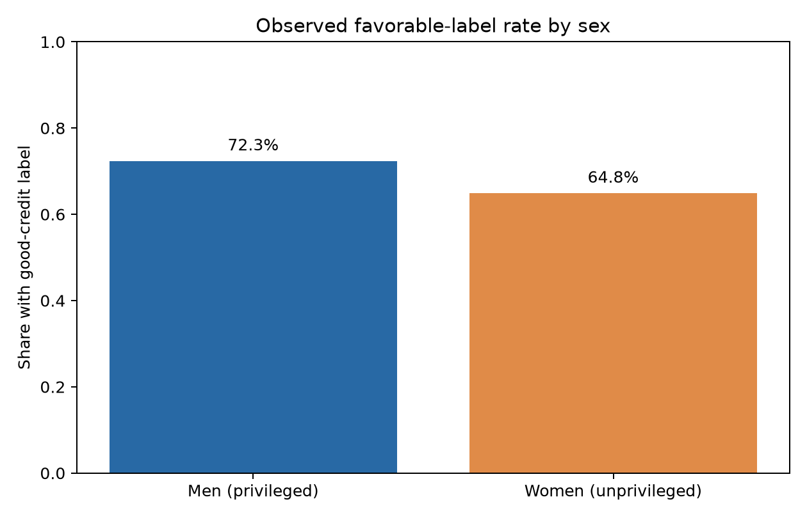
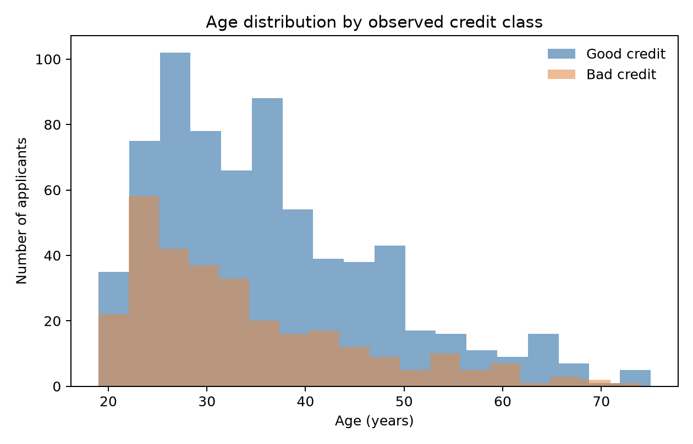
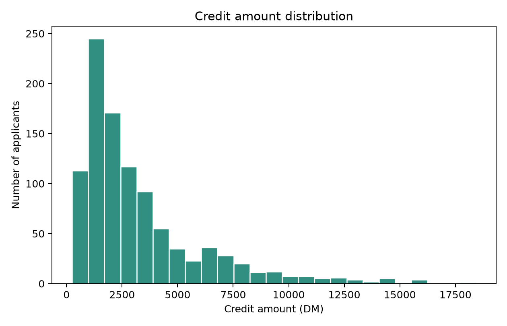
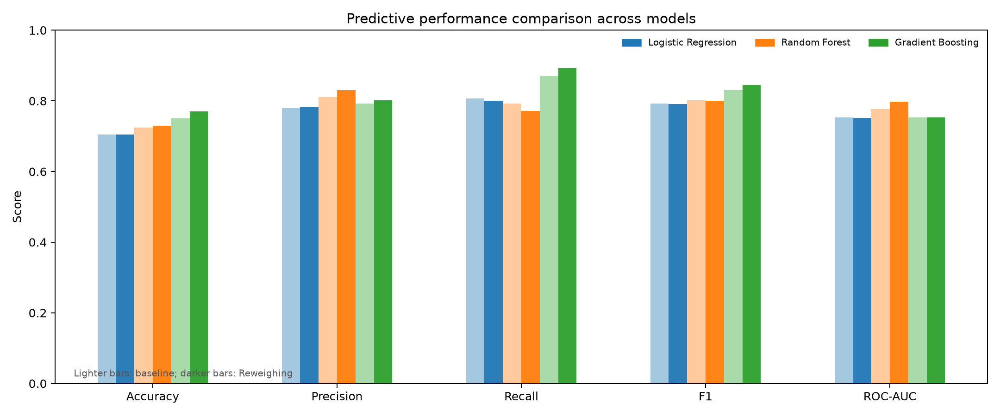
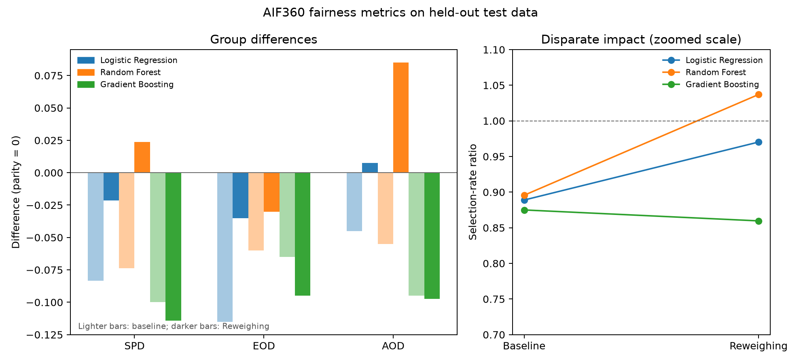

# Fairness Analysis of German Credit Classification
## A 15-page project report using IBM AI Fairness 360

**Project team:** Betel Negusu, Esrom Adugna, and Aklile Solomon

**Dataset:** UCI Statlog German Credit

**Purpose:** Reproducible educational analysis of group fairness in credit classification

**Scope note:** This benchmark experiment is not a lending recommendation or a determination of legal compliance.

---

## Page 1 of 15 — Cover and project record

This report documents the work completed for the German Credit Fairness Analysis project. The project takes a historical credit-classification dataset, prepares it for supervised learning, trains multiple models, measures performance and group disparities, applies a pre-processing mitigation, and presents the resulting evidence in a local dashboard and machine-readable outputs.

The central question is practical: when a classifier predicts whether an applicant belongs to the dataset's favorable credit class, do prediction rates and error rates differ between the sex groups available in this benchmark, and what changes when training examples are reweighted? The investigation treats that as an empirical question rather than assuming that any one model or metric can establish fairness.

The report is organized as fifteen explicitly numbered pages. Page breaks are marked for document or PDF renderers that support Markdown page-break directives. A renderer's font, margins, and image scaling can affect physical pagination; the page labels make the intended structure clear.

**Team members**

1. Betel Negusu
2. Esrom Adugna
3. Aklile Solomon

**Project outputs:** reproducible Python analysis, interactive Streamlit dashboard, summary presentation, plots, CSV tables, and JSON results.

\newpage

## Page 2 of 15 — Executive summary

This project examined the UCI Statlog German Credit benchmark, which contains 1,000 records and 20 model input features after the project’s feature engineering. The outcome was mapped so that the original good-credit class is favorable. The protected attribute was derived from the source personal-status/sex code: women (A92 and A95) were designated the unprivileged group, and men (A91, A93, and A94) the privileged group. This is an analysis-specific binary grouping, not a claim that sex is inherently binary.

The workflow used a stratified 80/20 train/test split with seed 42. A preprocessing pipeline median-imputes and standardizes numeric fields and most-frequent-imputes and one-hot encodes categorical fields. Logistic regression was selected as the primary model; random forest and gradient boosting broadened the comparison. Each was fitted with and without AIF360 Reweighing, using training-set weights only. Performance and fairness were then evaluated on the same held-out test cases.

The held-out test set contained 200 applicants. For the primary Logistic Regression model, accuracy changed from 0.705 to 0.705 and F1 from 0.793 to 0.792. SPD changed from -0.083 to -0.021, DI from 0.889 to 0.970, EOD from -0.115 to -0.035, and AOD from -0.045 to 0.008. The interpretation is limited to this split and these particular metrics.

The exercise demonstrates measurement, mitigation, and transparent reporting. It does not show that the model is suitable for real credit decisions, that observed differences are caused by sex, or that the intervention resolves every relevant harm.

\newpage

## Page 3 of 15 — Background and problem statement

Credit decisions can influence access to housing, education, transport, and financial stability. Automated classifiers may reproduce patterns in historical data, including patterns shaped by earlier access to credit, institutional practices, and proxies for sensitive circumstances. Aggregate model scores alone can therefore hide group-specific differences in who receives favorable predictions and who is incorrectly accepted or rejected.

This project uses a well-known benchmark to demonstrate a structured audit rather than to build a deployable scoring product. The dataset is small and historical, and its target is a recorded class rather than a complete or contemporary measure of a person's ability to repay. A good classification result on this data is not evidence that a real lending decision would be accurate, fair, lawful, or beneficial.

The analysis centers on two complementary questions. First, how do predictive performance and selected group-fairness measures compare for a baseline classifier? Second, how do those measurements change when AIF360 Reweighing is applied to training observations? Comparing both outcomes matters: one fairness measure can improve while another worsens, and fairness adjustments can change performance or error allocation.

The protected group is defined explicitly to make the experiment reproducible. The source field combines personal-status and sex codes, so the project maps only its documented codes to two audit groups. The audit retains a derived sex feature in the model and reports group metrics; it therefore examines direct as well as proxy-related association in this setup. Removing a sensitive field would not, by itself, guarantee that proxies are absent.

The problem is thus framed as an auditable modeling exercise: document assumptions, separate training and test information, measure several outcomes, present uncertainty, and describe the limits of interpretation.

\newpage

## Page 4 of 15 — Objectives, questions, and scope

The project objectives were:

1. Load and validate the public German Credit data and define a consistent favorable outcome and protected-group mapping.
2. Inspect data quality and distributions with descriptive statistics and exploratory plots.
3. Build a repeatable preprocessing and model-training workflow that keeps test data separate from fitting.
4. Compare three model families under baseline training and training-only Reweighing.
5. Report aggregate utility, group-level performance, and four AIF360 fairness measures.
6. Estimate resampling intervals for selected paired changes and publish results in accessible project artifacts.

The principal comparison is baseline versus Reweighing on the same split, with the same model family and 0.5 prediction threshold. Logistic regression is the main interpretive example because it is a familiar, relatively transparent classifier. Random forest and gradient boosting are supporting comparisons, not evidence that one family is universally superior.

The analysis measures accuracy, precision, recall, F1, ROC-AUC, SPD, DI, EOD, and AOD. It does not optimize the threshold, conduct a causal analysis, evaluate calibration or individual fairness, quantify monetary utility, test every possible intersectional subgroup, or assess a modern lending institution.

The 80/20 split and seed 42 define one reproducible experiment, not a comprehensive estimate of out-of-sample performance. A further assessment would require repeated or nested validation, stakeholder-selected costs, external validation, and additional context-specific measures. These boundaries prevent the report from overclaiming what the completed code can establish.

The project deliverable is an educational audit pipeline with transparent outputs, rather than a model intended for production decisions.

\newpage

## Page 5 of 15 — Data source, structure, and labels

The input is the UCI Machine Learning Repository's Statlog German Credit dataset, distributed as whitespace-delimited records. The project code downloads and caches the source file under `data/raw/` when it is not already present, assigns documented column names, and checks that there are 1,000 rows, expected target labels, and recognized personal-status/sex codes. Those checks make unexpected input changes visible rather than silently treating them as the same experiment.

There are 20 original applicant attributes and a target. The attributes describe areas such as checking account status, credit duration, credit history, purpose, credit amount, savings, employment, installment rate, housing, age, existing credit, and telephone/foreign-worker status. Many columns use category codes, so code values are not automatically treated as meaningful numeric scales.

The original target labels are 1 for good credit and 2 for bad credit. The analysis creates `credit_good`, with 1 as the favorable outcome and 0 as the unfavorable outcome. From `personal_status_sex`, codes A92 and A95 map to women (`sex = 1`); A91, A93, and A94 map to men (`sex = 0`). The original combined field is excluded from model features after this mapping to avoid retaining a duplicate representation; the derived audit attribute remains available to the model.

The recorded data contain 700 favorable labels (70.0%), 690 men and 310 women. The observed favorable-label rates are 72.3% for men and 64.8% for women. There are 0 missing cells; median age is 33.0 years and median credit amount is 2,320 DM. These descriptive statistics characterize this dataset and are not estimates for a current lending population.

\newpage

## Page 6 of 15 — Data quality and exploratory analysis

The analysis exports descriptive statistics for every input and derived field, a per-column missing-value summary, and favorable-label counts and rates by sex. The recorded data contain no missing cells. Imputation is still included in the preprocessing pipeline because it is a standard defensive step and makes the procedure explicit if the data later contain missing values.

The descriptive results give a median age of 33 years and median credit amount of 2,320 DM. The credit amount distribution is right-skewed relative to its median, and age distributions are examined separately for the two recorded outcome classes. A numeric correlation heatmap provides a compact view of linear relationships among numeric fields; it is descriptive and does not establish causal or predictive importance.

Four exploratory figures are generated: observed favorable-label rates by sex, age by credit class, credit-amount distribution, and numeric-feature correlations. The label-rate comparison shows a difference already present in observed outcomes, before any classifier is trained. That is important context: the model audit compares predictions against a dataset whose labels themselves may encode historical patterns.

Exploratory analysis serves two purposes here. It checks that data loading and derived variables are plausible, and it helps readers understand the composition and limitations of the benchmark. It is not a feature-selection protocol or a test of statistical significance. In particular, observed group differences in a sample do not identify their causes, and the benchmark does not include every factor that would be needed for a contemporary credit-risk or discrimination study.

The CSV and PNG outputs make the exploratory steps reviewable without rerunning the dashboard.

\newpage

## Page 7 of 15 — Feature preparation and leakage safeguards

The experiment reserves a stratified 20% holdout set before fitting the preprocessing pipeline. Stratification preserves the overall outcome proportions approximately across training and test partitions. The split uses random seed 42, making the result repeatable with compatible library versions and the same input data.

Numeric features pass through a median imputer and standard scaler. Categorical features pass through a most-frequent imputer followed by one-hot encoding. The derived `sex` column is handled as the protected numeric indicator rather than one-hot encoded as an ordinary category. The source `personal_status_sex` field, original target, and derived target are excluded from predictors. This leaves the intended predictor set and prevents direct target leakage.

The preprocessing transformer is fit as part of model training on the training partition only. This matters because imputation statistics, scaling means and variances, and category vocabularies must not be estimated from the held-out observations. The same fitted preprocessing design is used in each baseline and reweighed model comparison.

The file contains no missing values in the recorded run, so imputation does not change those rows. Including the step documents expected handling and prevents the code from depending on an accidental property of this particular data file.

Preprocessing choices influence model behavior and fairness metrics. Standardization can affect linear-model optimization; one-hot encoding avoids assigning arbitrary order to nominal categories. These are practical choices for this project, not proof that every feature is appropriate. A real decision process would require a separate justification of each field, its provenance, and its effect on applicants.

\newpage

## Page 8 of 15 — Models and evaluation protocol

Three scikit-learn classifiers are trained: logistic regression, random forest, and gradient boosting. Each is evaluated in two conditions, baseline and Reweighing, resulting in six model/method combinations. Logistic regression is designated the primary comparison in the narrative; the other two check whether conclusions observed for that model carry over to different model families.

All models use the same train/test split, predictor features, preprocessing strategy, and decision threshold of 0.5. The split is stratified and seeded with 42. The held-out test set has 200 records: 140 men and 60 women. This fixed design makes the within-model baseline/mitigated comparison clearer, although it does not eliminate sampling uncertainty.

The report gives accuracy (fraction of all cases classified correctly), precision (fraction of favorable predictions that are correct), recall or true-positive rate (fraction of favorable actual cases identified), F1 (harmonic mean of precision and recall), and ROC-AUC (ranking discrimination across thresholds). The chosen favorable class is good credit; consequently the positive class in these metrics is `credit_good = 1`.

No tuning on the test data is performed. The threshold is held fixed rather than selected to optimize a fairness metric after inspecting test outcomes. Keeping the threshold fixed helps isolate effects associated with training weights, but it does not establish that 0.5 is operationally optimal or acceptable. A deployment study would need a defensible decision threshold and explicit treatment of the different costs of false-positive and false-negative decisions.

\newpage

## Page 9 of 15 — Fairness measures and sign conventions

Fairness measures are computed with IBM AI Fairness 360 (AIF360). Women are the unprivileged group U; men are the privileged group P; good credit is favorable. Difference measures are reported as women minus men. Under that convention, zero is the parity reference for SPD, EOD, and AOD; 1 is the parity reference for DI.

**Statistical Parity Difference (SPD)** is the difference in favorable prediction rates: `Pr(ŷ=1|U) - Pr(ŷ=1|P)`. A negative value means women receive fewer favorable predictions in this test set. **Disparate Impact (DI)** is the ratio of those rates, `Pr(ŷ=1|U) / Pr(ŷ=1|P)`. A value below 1 means the women's rate is lower. The often-cited 0.80 ratio is only a screening heuristic here, not a universal fairness definition or legal conclusion.

**Equal Opportunity Difference (EOD)** is the difference in true-positive rates: `TPR_U - TPR_P`. It asks whether actual favorable cases in each group are identified at similar rates. **Average Odds Difference (AOD)** averages the group difference in true-positive rates and false-positive rates: `0.5 * ((TPR_U - TPR_P) + (FPR_U - FPR_P))`.

The measures represent different questions. SPD does not condition on observed outcome; EOD does not summarize false-positive differences; AOD can average away opposing component gaps; and DI is unstable or undefined if the privileged selection rate is zero. Parity on these measures is not equivalent to calibration, individual fairness, or absence of discrimination. They must be interpreted together with performance, data context, and consequences of errors.

\newpage

## Page 10 of 15 — Reweighing intervention

The mitigation used is AIF360's `Reweighing`, a pre-processing intervention. It assigns training-instance weights so that the association between protected-group membership and the observed outcome is reduced in the weighted training distribution. The project fits the reweigher using only training data and then supplies its instance weights to each classifier during fitting.

Reweighing does not delete the sex feature, change test labels, reweight test examples, or directly force predictions to satisfy a fairness constraint. The held-out data remain the original test population and are evaluated in the same way as the baseline. This design makes the comparison a test of the training-time weighting intervention under an otherwise shared split and evaluation procedure.

The method is a useful educational example because it illustrates how training data can be modified without changing the model's prediction interface. It also has limitations: the effect depends on observed group/outcome combinations, the chosen classifier, and finite-sample behavior. It cannot correct missing variables, biased labels, harmful feature choices, or institutional processes outside the dataset. Weighted training may improve some measured disparities while worsening others or reallocating errors.

For each model family, the report compares all four fairness measures and conventional performance before and after the intervention. The intervention is not declared successful based on one number. Instead, the result is described as a set of changes with uncertainty and with explicit caution against assuming that a metric change establishes real-world fairness.

\newpage

## Page 11 of 15 — Aggregate performance results

The following table reports held-out performance across all six experiments. Logistic regression is the primary narrative model; the other model families are included to show that results can depend on the learning algorithm.

| Model and method | Accuracy | Precision | Recall | F1 | ROC-AUC |
|---|---:|---:|---:|---:|---:|
| Logistic Regression (Baseline) | 0.705 | 0.779 | 0.807 | 0.793 | 0.754 |
| Logistic Regression (Reweighing) | 0.705 | 0.783 | 0.800 | 0.792 | 0.752 |
| Random Forest (Baseline) | 0.725 | 0.810 | 0.793 | 0.801 | 0.776 |
| Random Forest (Reweighing) | 0.730 | 0.831 | 0.771 | 0.800 | 0.798 |
| Gradient Boosting (Baseline) | 0.750 | 0.792 | 0.871 | 0.830 | 0.753 |
| Gradient Boosting (Reweighing) | 0.770 | 0.801 | 0.893 | 0.845 | 0.753 |

- **Logistic Regression:** accuracy changed from 0.705 to 0.705; F1 from 0.793 to 0.792; ROC-AUC from 0.754 to 0.752. The accuracy interval includes zero; the F1 interval includes zero.
- **Random Forest:** accuracy changed from 0.725 to 0.730; F1 from 0.801 to 0.800; ROC-AUC from 0.776 to 0.798. The accuracy interval includes zero; the F1 interval includes zero.
- **Gradient Boosting:** accuracy changed from 0.750 to 0.770; F1 from 0.830 to 0.845; ROC-AUC from 0.753 to 0.753. The accuracy interval includes zero; the F1 interval includes zero.

The performance comparison figure presents the same model families visually. No single classifier is designated a winner for deployment. Predictive performance is only one part of the decision, and the costs of incorrectly classifying applicants are not represented symmetrically by accuracy or F1.

\newpage

## Page 12 of 15 — Group performance and fairness results

The held-out test set contains 140 men and 60 women. The group table reports sample count, observed and predicted favorable rates, and performance measures for each model/method pair. The group-level estimates are less precise for women because the subgroup is smaller.

For Logistic Regression, women's test accuracy was 0.633 versus men's 0.736 at baseline, and 0.667 versus 0.721 after Reweighing. Women's predicted favorable rate changed from 0.667 to 0.700; men's changed from 0.750 to 0.721. The women-minus-men recall gap changed from -0.115 to -0.035. These are descriptive estimates, with smaller subgroup counts for women.

| Model and group | N | Observed good rate | Predicted good rate | Accuracy | Precision | Recall | F1 | ROC-AUC |
|---|---:|---:|---:|---:|---:|---:|---:|---:|
| Logistic Regression (baseline) / Men (privileged) | 140 | 0.714 | 0.750 | 0.736 | 0.800 | 0.840 | 0.820 | 0.784 |
| Logistic Regression (baseline) / Women (unprivileged) | 60 | 0.667 | 0.667 | 0.633 | 0.725 | 0.725 | 0.725 | 0.680 |
| Logistic Regression (Reweighing) / Men (privileged) | 140 | 0.714 | 0.721 | 0.721 | 0.802 | 0.810 | 0.806 | 0.785 |
| Logistic Regression (Reweighing) / Women (unprivileged) | 60 | 0.667 | 0.700 | 0.667 | 0.738 | 0.775 | 0.756 | 0.679 |
| Random Forest (baseline) / Men (privileged) | 140 | 0.714 | 0.707 | 0.736 | 0.818 | 0.810 | 0.814 | 0.809 |
| Random Forest (baseline) / Women (unprivileged) | 60 | 0.667 | 0.633 | 0.700 | 0.789 | 0.750 | 0.769 | 0.698 |
| Random Forest (Reweighing) / Men (privileged) | 140 | 0.714 | 0.643 | 0.757 | 0.867 | 0.780 | 0.821 | 0.835 |
| Random Forest (Reweighing) / Women (unprivileged) | 60 | 0.667 | 0.667 | 0.667 | 0.750 | 0.750 | 0.750 | 0.704 |
| Gradient Boosting (baseline) / Men (privileged) | 140 | 0.714 | 0.800 | 0.757 | 0.795 | 0.890 | 0.840 | 0.791 |
| Gradient Boosting (baseline) / Women (unprivileged) | 60 | 0.667 | 0.700 | 0.733 | 0.786 | 0.825 | 0.805 | 0.682 |
| Gradient Boosting (Reweighing) / Men (privileged) | 140 | 0.714 | 0.814 | 0.786 | 0.807 | 0.920 | 0.860 | 0.798 |
| Gradient Boosting (Reweighing) / Women (unprivileged) | 60 | 0.667 | 0.700 | 0.733 | 0.786 | 0.825 | 0.805 | 0.671 |

| Measure | Baseline | Reweighing | Change |
|---|---:|---:|---:|
| SPD | -0.083 | -0.021 | +0.062 |
| DI | 0.889 | 0.970 | +0.081 |
| EOD | -0.115 | -0.035 | +0.080 |
| AOD | -0.045 | 0.008 | +0.052 |

Across model families, Reweighing did not produce identical outcomes. The full fairness table below reports each model's baseline and reweighed values:

- **Logistic Regression:** SPD, DI, EOD, AOD moved closer to parity.
- **Random Forest:** SPD, DI, EOD moved closer to parity; AOD moved farther from parity.
- **Gradient Boosting:** SPD, DI, EOD, AOD moved farther from parity.

| Model | Measure | Baseline | Reweighing | Change |
|---|---|---:|---:|---:|

| Logistic Regression | SPD | -0.083 | -0.021 | +0.062 |
| Logistic Regression | DI | 0.889 | 0.970 | +0.081 |
| Logistic Regression | EOD | -0.115 | -0.035 | +0.080 |
| Logistic Regression | AOD | -0.045 | 0.008 | +0.052 |
| Random Forest | SPD | -0.074 | 0.024 | +0.098 |
| Random Forest | DI | 0.896 | 1.037 | +0.141 |
| Random Forest | EOD | -0.060 | -0.030 | +0.030 |
| Random Forest | AOD | -0.055 | 0.085 | +0.140 |
| Gradient Boosting | SPD | -0.100 | -0.114 | -0.014 |
| Gradient Boosting | DI | 0.875 | 0.860 | -0.015 |
| Gradient Boosting | EOD | -0.065 | -0.095 | -0.030 |
| Gradient Boosting | AOD | -0.095 | -0.098 | -0.003 |

The group and comparison figures complement these tables. Differences are descriptive model results, not causal estimates of the effect of sex.

\newpage

## Page 13 of 15 — Uncertainty and robustness

The pipeline uses 1,000 paired bootstrap resamples, stratified by the intersection of sex and observed outcome, with seed 42. Within each resample, baseline and Reweighing predictions are evaluated on the same sampled test cases. The reported difference is mitigated minus baseline, and the interval is a descriptive 95% resampling interval for the selected metric changes.

The primary-model intervals are summarized below: ACCURACY change was +0.000 (95% interval [-0.025, +0.020]; includes zero). F1 change was -0.001 (95% interval [-0.021, +0.017]; includes zero). SPD change was +0.062 (95% interval [+0.017, +0.119]; excludes zero). DI change was +0.079 (95% interval [+0.022, +0.166]; excludes zero). EOD change was +0.080 (95% interval [+0.020, +0.165]; excludes zero). AOD change was +0.052 (95% interval [+0.015, +0.100]; excludes zero). For other models, the complete table shows the corresponding changes and intervals.

| Model | Metric | Change | 95% interval | Excludes zero? |
|---|---|---:|---:|:---:|
| Logistic Regression | ACCURACY | +0.000 | [-0.025, +0.020] | No |
| Logistic Regression | F1 | -0.001 | [-0.021, +0.017] | No |
| Logistic Regression | SPD | +0.062 | [+0.017, +0.119] | Yes |
| Logistic Regression | DI | +0.079 | [+0.022, +0.166] | Yes |
| Logistic Regression | EOD | +0.080 | [+0.020, +0.165] | Yes |
| Logistic Regression | AOD | +0.052 | [+0.015, +0.100] | Yes |
| Random Forest | ACCURACY | +0.005 | [-0.030, +0.040] | No |
| Random Forest | F1 | -0.001 | [-0.027, +0.022] | No |
| Random Forest | SPD | +0.095 | [+0.024, +0.176] | Yes |
| Random Forest | DI | +0.135 | [+0.033, +0.271] | Yes |
| Random Forest | EOD | +0.030 | [-0.045, +0.105] | No |
| Random Forest | AOD | +0.135 | [+0.048, +0.240] | Yes |
| Gradient Boosting | ACCURACY | +0.020 | [-0.010, +0.055] | No |
| Gradient Boosting | F1 | +0.015 | [-0.009, +0.040] | No |
| Gradient Boosting | SPD | -0.014 | [-0.098, +0.074] | No |
| Gradient Boosting | DI | -0.015 | [-0.118, +0.092] | No |
| Gradient Boosting | EOD | -0.030 | [-0.150, +0.100] | No |
| Gradient Boosting | AOD | -0.003 | [-0.062, +0.065] | No |

These intervals are not confirmatory hypothesis tests, do not adjust for multiple comparisons, and do not account for uncertainty from choosing a single train/test split or model specification. Exclusion of zero is not proof of fairness or practical importance; inclusion of zero is not proof of equivalence. Small subgroup counts and fixed observed labels limit what this resampling can say.

\newpage

## Page 14 of 15 — Interpretation, limitations, and responsible use

The benchmark has material limitations. It is small, historical, and geographically and institutionally distinct from present-day credit markets. Its outcome is a recorded label, not a complete ground truth about repayment potential. The group attribute is derived from a binary mapping of a combined source field and cannot represent broader sex or gender identities. Women account for 31% of the full dataset and 30% of the test set; intersectional subgroup sizes would be smaller still.

The reported metrics do not encode all consequences. The UCI dataset documentation describes asymmetric costs for misclassification, whereas the reported accuracy and F1 do not encode those dataset-provided costs. A consequential assessment would need affected stakeholders to determine which errors matter, whether those costs are represented appropriately, and whether the model should be used at all. The study also does not evaluate calibration, causal fairness, individual-level consistency, privacy risk, or legal compliance.

Measured differences do not prove that sex caused model behavior or that a historical decision process discriminated. Conversely, an apparent parity metric cannot prove that a system is harmless. Proxy variables may carry information about protected status even when a protected column is omitted. Reweighing cannot repair poor labels, unsuitable purpose, or inadequate recourse.

Before any real-world use, an organization would need a lawful and documented purpose, privacy and security review, feature justification, independent validation, stakeholder input, accessible explanations, meaningful human review and appeal, and clear accountability. Monitoring should include subgroup rates, errors, calibration, data drift, uncertainty, missingness, and intersectional slices, with named owners and escalation/rollback criteria. This project makes no deployment recommendation.

\newpage

## Page 15 of 15 — Deliverables, reproducibility, and conclusion

The repository includes the analysis pipeline (`german_fairness.py`), local Streamlit interface (`app.py`), a command-line prediction prototype (`predict_credit.py`), and this report. The generated `outputs/` directory contains `metrics.csv`, `group_metrics.csv`, `bootstrap_differences.csv`, `descriptive_statistics.csv`, `missing_values.csv`, `outcome_by_sex.csv`, `results.json`, six figure files, and a 12-slide PowerPoint presentation. The dashboard presents overview metrics, subgroup comparisons, exploratory figures, and the report; analysis is run locally.

The command-line prototype is separate from the experiment: it applies a hand-written rule-based score and does not load any of the trained classifiers. Its displayed score is not a calibrated probability, and it is not included in the reported model metrics or fairness results. It is for demonstration only.

To reproduce the analysis from the repository root, create a Python environment, install `requirements.txt`, and run `python german_fairness.py`. The script downloads and caches the UCI source file if needed. To open the dashboard, run `python -m streamlit run app.py`. The experimental settings are seed 42, test fraction 0.20, prediction threshold 0.5, and 1,000 bootstrap replicates. Library versions can affect exact outputs; the exported JSON and CSV files provide the recorded result set.

**Conclusion.** This project completed a reproducible workflow for data inspection, preprocessing, classification, training-only Reweighing, group-fairness measurement, resampling, and communication through code, tables, figures, a dashboard, and a presentation. In the primary model, selected fairness gaps narrowed while accuracy stayed constant and F1 changed only slightly. Effects differed across models, and uncertainty and dataset limitations remain substantial. These findings are evidence about one experiment on one historical benchmark only.

**Source:** Hofmann, H. (1994). *Statlog (German Credit Data)*. UCI Machine Learning Repository. https://doi.org/10.24432/C5NC77. Dataset landing page: https://archive.ics.uci.edu/dataset/144/statlog+german+credit+data.

**Fairness library:** IBM AI Fairness 360 (AIF360), used for Reweighing and group fairness metrics. See the project dependency list for the tested package constraint.
